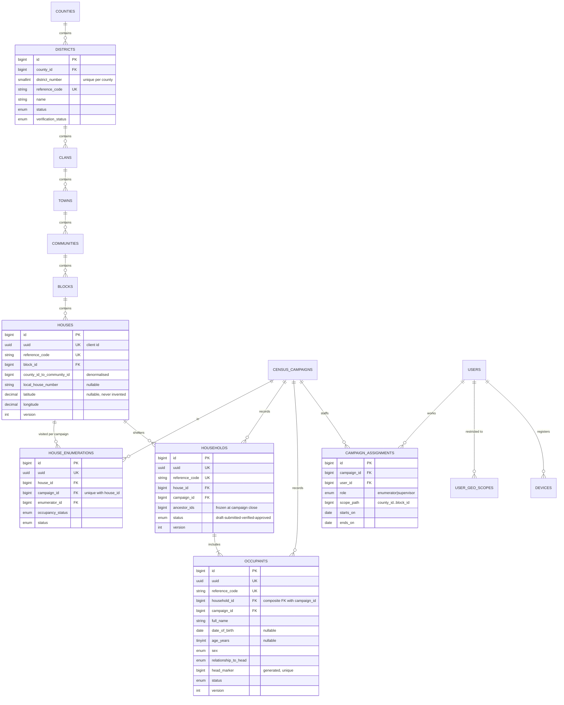

# LCCMS Phase 1: Architecture, Geographic Model and ER Diagram

## 1. Environment findings (verified in `C:\projects\lccms`, 2026-10-11)

| Item                    | Found                                                                                                                                                                                                                                                                                              | Status                                        |
| ----------------------- | -------------------------------------------------------------------------------------------------------------------------------------------------------------------------------------------------------------------------------------------------------------------------------------------------- | --------------------------------------------- |
| PHP                     | 8.4.25 (Windows, ZTS); bcmath, gd, intl, fileinfo, pdo_mysql, openssl loaded                                                                                                                                                                                                                       | OK for Laravel 13                             |
| Laravel                 | 13.35.0                                                                                                                                                                                                                                                                                            | OK                                            |
| MySQL                   | server reports `26.7.0`, `lccms` schema holds only the 17 starter tables (all empty)                                                                                                                                                                                                               | OK (≥ 8)                                      |
| Node / npm / pnpm       | 24.20 / 12.2 / 11.25                                                                                                                                                                                                                                                                               | OK                                            |
| Inertia                 | inertia-laravel 3.5.1, @inertiajs/react 3.9.1                                                                                                                                                                                                                                                      | OK                                            |
| React / TS              | 19.2 / 5.7, React Compiler enabled, vite-plus (`vp`) toolchain                                                                                                                                                                                                                                     | OK                                            |
| Auth                    | Fortify 1.41 starter kit: login, registration, email verification, password reset, TOTP 2FA, passkeys                                                                                                                                                                                              | Reuse                                         |
| Installed, not yet used | spatie/laravel-permission 8.3, spatie/laravel-activitylog 5.1, spatie/laravel-honeypot, sanctum 4.3, maatwebsite/excel 4, barryvdh/laravel-dompdf 3, intervention/image-laravel 4, dexie 4, leaflet + react-leaflet 5, recharts 3, @tanstack/react-table, react-hook-form + zod 4, vite-plugin-pwa | Reuse, no new installs needed for most phases |
| Baseline tests          | 40 passed (Pest 5)                                                                                                                                                                                                                                                                                 | OK                                            |
| Baseline `tsc --noEmit` | 3 errors in generated `resources/js/actions/Illuminate/Routing/RedirectController.ts`                                                                                                                                                                                                              | Pre-existing, see §3                          |

Note: `sodium` and `exif` are not loaded in this PHP build. Neither is required. EXIF stripping is done by re-encoding through Intervention/GD.

## 2. Corrections to the earlier draft of this document

The earlier draft described a different sandbox (PHP 8.3, no MySQL, empty repo). It was wrong on these points, which affect the design:

- The project is **not greenfield**. It is the Laravel React starter kit with Fortify 2FA and passkeys already in place. That auth stays as it is.
- **Audit logging uses spatie/laravel-activitylog** (already installed and migrated) with a PII redactor. No separate `audit_logs` table, which would duplicate it. Domain history tables such as `record_reviews` and `complaint_status_history` are business data and stay.
- **No new `app/Domain` base folder.** The project rules forbid new base folders without approval. Code instead goes in standard Laravel folders with domain sub-namespaces (§6).
- **The test database is SQLite `:memory:`** (`phpunit.xml`), but the schema relies on MySQL features: composite foreign keys, generated columns, CHECK constraints, and `SELECT … FOR UPDATE` locking. Proposal: a dedicated `lccms_testing` MySQL database for the test suite (decision needed, §8).
- **Redis/Horizon are not available locally.** The phpredis extension is not loaded, and Horizon needs `pcntl`, which Windows lacks. Locally, queues and cache stay on the `database` driver. Horizon is a production-only (Linux) concern and needs approval before it's added.

## 3. Baseline issues found

1. **Wayfinder type error.** In Laravel 13, `Route::redirect()` registers the `QUERY` verb too, but Wayfinder 0.1.21's `Method` type does not include `query`. The source is `routes/settings.php:9`. Fix in Phase 2: replace the `Route::redirect` with a GET-only redirect route. Generated files are never hand-edited.
2. **Two JS lockfiles** (`package-lock.json` and `pnpm-lock.yaml`). One package manager should be canonical (decision needed).
3. `.env` holds Mailtrap sandbox credentials. That's fine for local use, but the file must never be committed, and production secrets come from the environment.

## 4. Geographic model (authoritative hierarchy)

County → District → Clan → Town → Community → Block → House → Household → Occupant

- **Six typed tables** for the administrative levels, each with a mandatory foreign key to its parent, so an illegal parent cannot exist.
- **Denormalised ancestor columns.** `communities` and everything below carry `county_id … block_id` as applicable. A single `GeographyPathResolver` writes them, and a scheduled `geography:reconcile` command checks them. This gives single-index scope filters and `GROUP BY` at any level without recursive joins.
- **District numbering.** `districts.district_number` is unique **per county**: `UNIQUE(county_id, district_number)`.
- **Names.** Names are unique per parent on a normalised name: `UNIQUE(parent_id, normalized_name)`. Fuzzy duplicate detection (Soundex plus Levenshtein on `normalized_name`) flags likely duplicates for review instead of blocking.
- **Reference codes.** Codes are server-generated, human-readable and immutable. Offline-created records also carry a client `uuid`.
- **Reassignment workflow.** `geo_reassignments` covers request → authorised approval → apply in one transaction → activity log. The record stores the before and after ancestor paths and the effective date.
- **Historical preservation.** Census rows (`households`, `occupants`, `house_enumerations`) carry their own ancestor columns. A reassignment updates the live register (`houses`, geography) and rows in _open_ campaigns. It never touches rows of `closed`/`archived` campaigns, so their ancestor columns stay frozen and approved results never shift. No separate JSON snapshot is needed.
- **Development fixtures.** No official Liberian records are invented. Seeders create fixtures marked `is_fixture = true`, with reference codes prefixed `DEV-`, and a guard refuses to seed fixtures when `APP_ENV=production`.

House vs household vs occupant:

- `houses` is the stable physical register. It is campaign-independent.
- `house_enumerations` holds the per-campaign visit and status of a house.
- `households` is a social unit in one house **for one campaign**. A house can have many.
- `occupants` are persons in exactly one household, and therefore one house and one campaign.

## 5. Entity-relationship diagram

### 5.1 Core census (with key columns)

### 5.2 Supporting domains

```mermaid
erDiagram
    SYNC_BATCHES ||--o{ SYNC_OPERATIONS : holds
    SYNC_OPERATIONS ||--o| SYNC_CONFLICTS : "may raise"
    DEVICES ||--o{ SYNC_BATCHES : submits
    OCCUPANTS ||--o{ DUPLICATE_FLAGS : flagged
    HOUSEHOLDS ||--o{ RECORD_REVIEWS : "reviewed (morph)"
    OCCUPANTS ||--o{ RECORD_CORRECTIONS : "corrected (morph)"

    FACILITY_TYPES ||--o{ FACILITIES : classifies
    COMMUNITIES ||--o{ FACILITIES : hosts
    BLOCKS ||--o{ FACILITIES : "may host"
    FACILITIES ||--o| FACILITY_PROFILES : "type-specific 1:1"
    FACILITIES ||--o{ FACILITY_INSPECTIONS : inspected
    COMMUNITIES ||--o{ COMMUNITY_SERVICE_ASSESSMENTS : "present / verified absent"

    LEADERSHIP_POSITIONS ||--o{ LEADERSHIP_TENURES : "filled by"
    COMMUNITIES ||--o{ LEADERSHIP_TENURES : "led (XOR block)"
    BLOCKS ||--o{ LEADERSHIP_TENURES : led

    COMMUNITIES ||--o{ INFRASTRUCTURE_ASSETS : has
    COMMUNITIES ||--o{ DEVELOPMENT_PROJECTS : has
    DEVELOPMENT_PROJECTS ||--o{ PROJECT_MILESTONES : has

    COMMUNITIES ||--o{ MEDIA_ITEMS : gallery
    COMMUNITIES ||--o{ EVENTS : hosts
    POSTS }o--o{ TAGS : tagged
    POST_CATEGORIES ||--o{ POSTS : groups

    COMPLAINTS ||--o{ COMPLAINT_ATTACHMENTS : "slot 1-5"
    COMPLAINTS ||--o{ COMPLAINT_STATUS_HISTORY : tracks
    COMPLAINTS ||--o{ COMPLAINT_NOTES : internal
    USERS ||--o{ COMPLAINTS : assigned

    IMPORT_JOBS ||--o{ IMPORT_ROW_ERRORS : reports
    USERS ||--o{ EXPORT_JOBS : requests
```

Relationships in words:

- A household belongs to one house and one campaign. The same physical house appears across campaigns through `house_enumerations`, while `houses` stays the single register entry. A new campaign creates new household and occupant rows, so earlier campaigns are never overwritten.
- An occupant belongs to one household. The composite FK `(household_id, campaign_id) → households(id, campaign_id)` makes a campaign mismatch impossible.
- The household head is derived from `relationship_to_head = 'head'`. A generated column with a unique index allows at most one head per household. There is no circular `head_occupant_id` FK.
- A facility has exactly one `facility_type_id` and one `ownership` value, so it counts once per category.
- A leadership tenure belongs to exactly one of community or block, enforced by CHECK.

## 6. Code layout (standard Laravel folders, domain sub-namespaces)

| Kind                             | Location                                                                                             |
| -------------------------------- | ---------------------------------------------------------------------------------------------------- |
| Models                           | `app/Models/{Geography,Census,Sync,Facilities,Leadership,Infrastructure,Content,Complaints,Access}/` |
| Actions (single workflow step)   | `app/Actions/{Geography,Census,Sync,…}/`, alongside the existing `app/Actions/Fortify`               |
| Services (cross-cutting queries) | `app/Services/{GeoScope,Reports,Sync,…}`                                                             |
| Controllers                      | `app/Http/Controllers/{Admin,Public,Api/V1}/…` (thin)                                                |
| Form Requests / Resources        | `app/Http/Requests/<Domain>/`, `app/Http/Resources/<Domain>/`                                        |
| Policies / Enums                 | `app/Policies/`, `app/Enums/<Domain>/`                                                               |
| React pages                      | `resources/js/pages/{admin,public,field}/…`                                                          |
| Offline client                   | `resources/js/offline/` (Dexie DB, crypto, outbox, sync engine)                                      |

`app/Services` and `app/Enums` would be new folders under `app/`, not new base folders. Cross-domain writes go through Actions.

## 7. Implementation sequence

| Phase                       | Scope                                                                                                                                                                                                                                   | Exit criteria                                              |
| --------------------------- | --------------------------------------------------------------------------------------------------------------------------------------------------------------------------------------------------------------------------------------- | ---------------------------------------------------------- |
| 2 Foundation                | Wayfinder fix; roles and permissions seeder (15 roles); `user_geo_scopes` + `GeoScope` service + `GeoScoped` trait; activitylog redactor; staff-only registration (public sign-up disabled); admin layout and navigation; MySQL test DB | Auth, permission and scope tests pass; tsc clean; build OK |
| 3 Geography                 | Six levels CRUD, cascading selectors, breadcrumbs, search, duplicate flags, CSV/XLSX import with preview, reassignment workflow                                                                                                         | Hierarchy integrity and import tests                       |
| 4 Census                    | Campaigns, assignments, houses, enumerations, households, occupants, review and approval, corrections, duplicate review, aggregate reports                                                                                              | Aggregation and history tests                              |
| 5 Offline                   | PWA shell, encrypted Dexie store, package download, outbox, sync API, conflicts UI                                                                                                                                                      | The 8 acceptance scenarios (see 03)                        |
| 6 Facilities and leadership | Facility register and profiles, inspections, service assessments, leadership tenures, infrastructure and projects                                                                                                                       | Classification and tenure tests                            |
| 7 Public site               | Home, community profiles, gallery, events, blog, about, contact                                                                                                                                                                         | Redaction tests                                            |
| 8 Complaints                | Submission, 5-image enforcement, tracking token, workflow                                                                                                                                                                               | Upload security tests                                      |
| 9 Reports and maps          | Dashboards, drill-down, exports (CSV/XLSX/PDF), comparisons, Leaflet maps                                                                                                                                                               | Export permission tests                                    |
| 10 Hardening                | Security review, performance, backup and restore runbook, deployment docs                                                                                                                                                               | Full suite and build                                       |

## 8. Decisions needed before Phase 2

1. **Test database.** Switch feature tests to a MySQL `lccms_testing` database (recommended), or keep SQLite and lose MySQL-constraint coverage.
2. **Package manager.** npm or pnpm. Remove the other lockfile.
3. **Code layout.** Confirm the Laravel-standard layout in §6. The alternative is approving a new `app/Domain` base folder.
4. **New dependencies (later phases).** Approval is needed for `mews/purifier` (rich-text sanitising, Phase 7), `laravel/horizon` (production queues only, Phase 10), and optionally `@playwright/test` plus `fake-indexeddb` (offline integration tests, Phase 5).
5. **External inputs.** The source of official geographic data, the map tile provider (OpenStreetMap's public tiles are not licensed for heavy production use), the approved list of census variables, the legal basis and retention periods, and the SMS and email provider.
